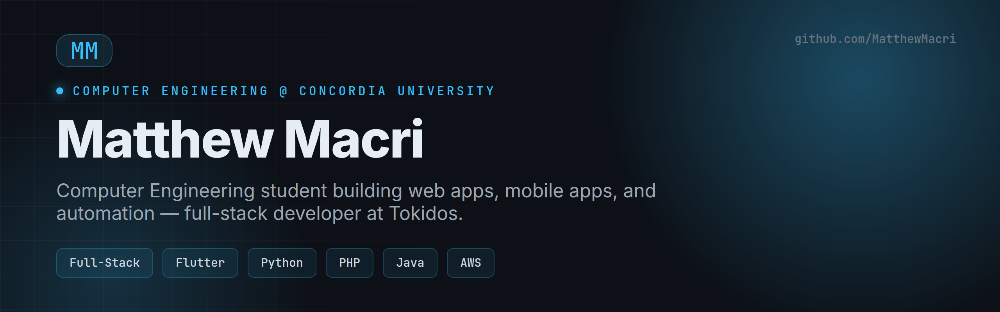

<h1 align="center">Hi, I'm Matthew Macri 👋</h1>

  <b>Computer Engineering student at Concordia University · Full-Stack Developer at Tokidos</b> 
  I build web apps, mobile apps, and automation tools — and I like shipping things that actually get used.

  
  
  

---

## 🧑‍💻 About Me

- 🎓 Studying **Computer Engineering** at **Concordia University** — following my Computer Science studies at Vanier College (Dean's List ×3)
- 💼 **Full-stack developer at Tokidos**, building internal tools for customer support and operations
- 🛠️ I work across the stack: web front-ends, Flask/PHP back-ends, Flutter mobile apps, and Python automation
- 🏆 Hackathons: VanierHacks 2025 (honourable mention), McGill Physics Hackathon, Bell Hackathon, Quebec Hackathon
- 📫 Reach me at **matthewmacri11@gmail.com** or on [LinkedIn](https://www.linkedin.com/in/m-macri/)

## 🧰 Tech Stack

**Languages**

**Frameworks & Tools**

**Data & Cloud**

## 🚀 Featured Projects

| Project | What it is | Built with |
|---------|-----------|------------|
| [**Developer Portfolio**](https://github.com/MatthewMacri/Portfolio-Website-Project) | My responsive personal portfolio site | HTML · CSS · JS · Bootstrap |
| [**Car Reservation System**](https://github.com/MatthewMacri/Application-Development-Project) | Bilingual C# desktop app for car rentals (MVC) | C# · .NET · SQLite |
| [**School Registration System**](https://github.com/MatthewMacri/Programming-Patterns-Project) | Java course-registration app with design patterns | Java · JDBC · MVC |
| [**SecureSend**](https://github.com/MatthewMacri/QuebecHackathon2023) | Encrypted file vault with shareable keys (hackathon) | Python · Flask · SQLAlchemy |
| [**Inventory Management System**](https://github.com/MatthewMacri/SysDevProject) | Web app for a manufacturing company | PHP · Laravel · MySQL |
| [**C$50 Finance**](https://github.com/MatthewMacri/Finance-CS50-Project) | Stock-trading web app (Harvard CS50) | Python · Flask · SQLite |
| [**Gym Management App**](https://github.com/MatthewMacri/AppDevProject) | Flutter app with member/employee/admin roles | Flutter · Firebase |
| [**Weather Website**](https://github.com/MatthewMacri/Internet-Programming-Project) | Live weather search with maps & history | JavaScript · jQuery · Ajax |

## 📊 GitHub Stats

  
  

  

---

<i>Always building. Open to internships and collaboration.</i>

